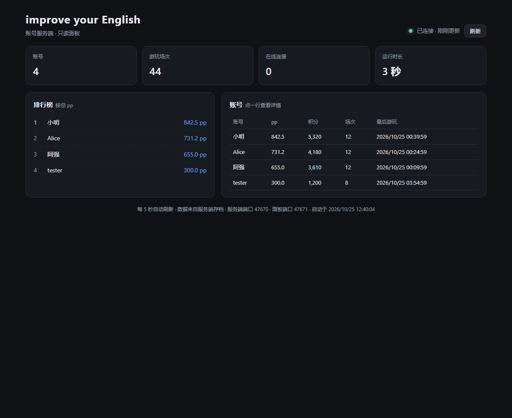
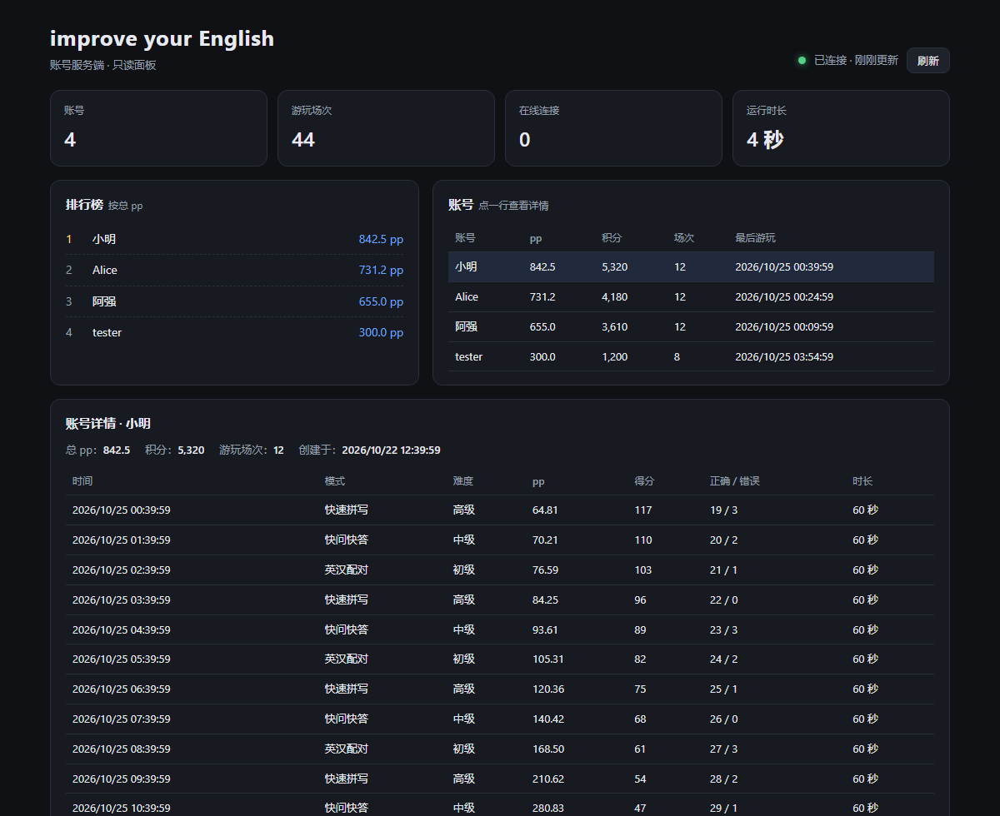

# 账号服务端

在线模式的服务端，和游戏共用同一个 Godot 工程，用 headless 方式跑，不需要额外装语言或数据库。

## 一键启动（Windows）

双击项目根目录的 **`start_server.bat`** 就行。它会：

1. 读取 `server/server.cfg`（没有就用默认值）
2. 自动查找 Godot（先找命令行、`GODOT_BIN`，再找项目上级目录和常见安装位置，取版本最新的一个）
3. 检查账号端口和面板端口有没有被占用
4. 打印局域网地址，启动服务端，并在浏览器里打开面板

第一次运行时 Windows 可能弹防火墙提示，允许「专用网络」即可。按 `Ctrl+C` 停止。

配置都在 `server/server.cfg` 里：

```ini
port=9000            # 账号端口（客户端填这个）
web_port=8080        # 面板端口
admin_password=      # 面板密码，留空则只有本机能看面板
data=                # 数据文件，留空用默认位置
godot=               # Godot 路径，留空自动查找
open_panel=1         # 启动后自动开面板
```

临时改也可以直接传参数：

```bat
start_server.bat -Port 9100 -WebPort 8180 -AdminPassword 123456
start_server.bat -NoBrowser
```

## 手动启动

```bash
godot --headless --path . res://server/server_main.tscn -- --port=9000 --data=user://server/accounts.json
```

- `--port`：监听端口，默认 9000；`--data`：账号数据文件，默认 `user://server/accounts.json`。
- 在 Windows 上数据文件位于 `%APPDATA%\Godot\app_userdata\improve your English\server\accounts.json`。
- 首次启动会自动建目录和文件。要备份就复制这个 json。

## 面板

服务端自带一个只读网页面板，用浏览器打开就能看账号、pp、排行榜和每个人的最近战绩，不用去翻 json。



点开某个账号可以看他的最近 30 场：



默认地址 `http://127.0.0.1:8080/`，只有本机能打开。想从别的电脑或手机看：

```bash
godot --headless --path . res://server/server_main.tscn -- \
  --port=9000 --web-port=8080 --admin-password=换成你自己的密码
```

- 设置 `--admin-password` 后，面板会要求输入用户名 + 密码（用户名随便填，密码是这个值），并默认监听 `0.0.0.0`。
- 还可以用 `--web-host=` 指定监听地址，`--web-port=` 改端口。
- 页面每 5 秒自动刷新；点账号行看该账号最近 30 场；地址栏 `#account=名字` 可以直接打开某个人。

面板提供的接口（都只读）：

| 路径 | 内容 |
| --- | --- |
| `GET /` | 面板页面 |
| `GET /api/summary` | 账号数、总场次、在线连接、运行时长、pp 前 10 |
| `GET /api/accounts` | 账号列表（pp、积分、场次、最后游玩） |
| `GET /api/account?name=xxx` | 单个账号 + 最近 30 场 |

> 面板只返回展示需要的字段，不会返回密码哈希。但还是建议设一个密码，别把面板直接暴露在公网上。

## 部署到公网

1. 找一台有公网 IP 的机器（VPS / 家里的电脑 + 端口映射）。
2. 把整个工程拷过去，装 Godot 4.7（headless 版即可）。
3. 用上面的命令启动，把端口在防火墙/安全组里放行（TCP）。
4. 客户端在「在线模式」里填 `公网IP:端口`。

局域网内直接填服务端的局域网 IP。

## 协议

TCP，一行一个 JSON 请求，响应里带回同样的 `id`：

| op | 请求 | 响应 |
| --- | --- | --- |
| `register` | `{name, password}` | `{ok, token, account}` |
| `login` | `{name, password}` | `{ok, token, account}` |
| `upload` | `{token, account}` | `{ok, total_pp, total_score}` |
| `profile` | `{token}` | `{ok, account}` |
| `leaderboard` | `{limit}` | `{ok, players:[{name, pp, score}]}` |
| `ping` | – | `{ok, time}` |

## 安全说明

- 密码只保存随机盐 + SHA-256 的哈希，不保存明文。
- 上传时服务端会按 `plays` 重算积分和总 pp，并把记录标记为 `online`，客户端直接改数字没有意义。
- 通信是明文 TCP，没有做传输加密。公开部署时建议放在内网 / VPN 后面，或者自己加一层 TLS 代理。
- token 只存在内存里，服务端重启后需要重新登录。
